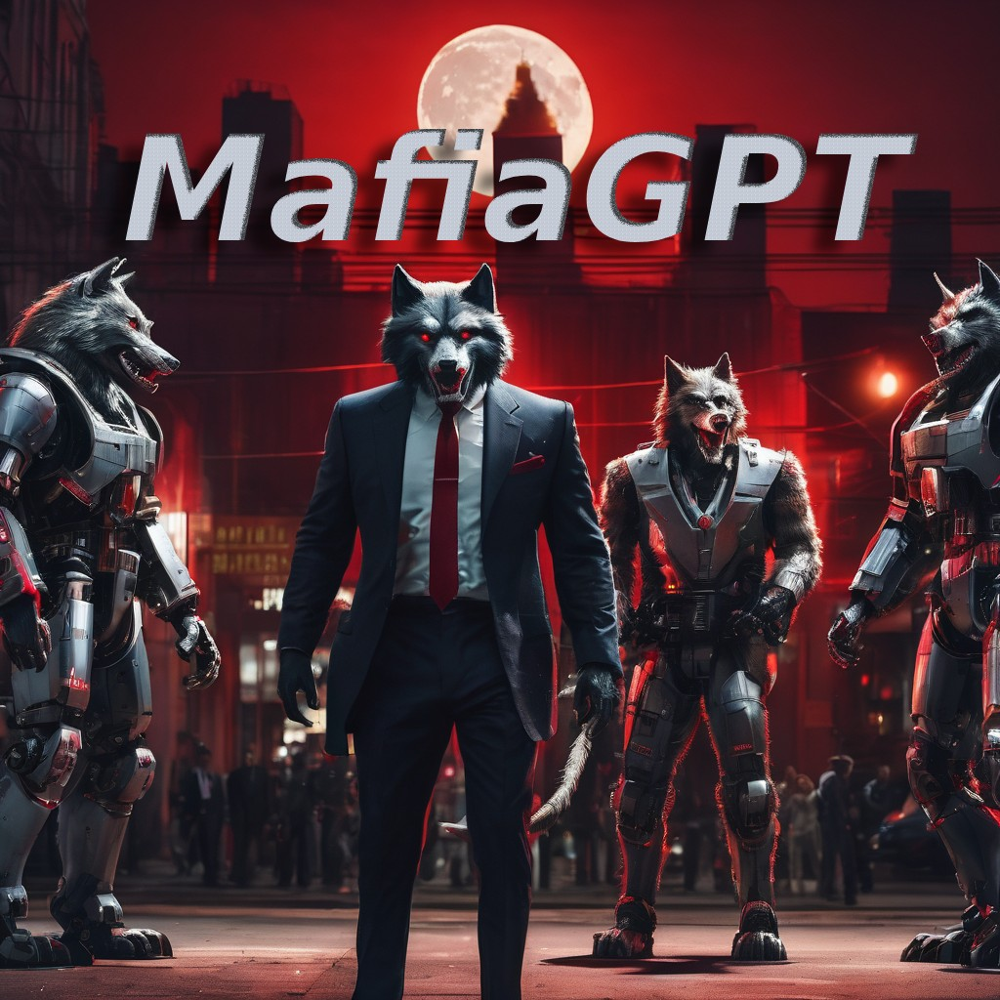

# MafiaGPT



a program that moderates a [Mafia (Werewolf)](https://en.wikipedia.org/wiki/Mafia_(party_game)) game with LLMs as the players.

to see communication, team work and social/logical abilities of GPT model.(it is fun and educational)

the roles are : 

- 1 Medical
- 1 Seer
- 3 Villagers
- 2 Werewolves

## Get started

### Local (uv + Python 3.12)

1. Install [uv](https://github.com/astral-sh/uv) and Python 3.12.
2. Create your environment variables (see `.env.example`):

```shell
export OPENROUTER_API_KEY=your_openrouter_api_key_here
```

3. Install dependencies and run:

```shell
uv pip install -e .
python -m mafiagpt
```

### Docker

```shell
docker build -t mafiagpt .
docker run --rm -e OPENROUTER_API_KEY=your_openrouter_api_key_here mafiagpt
```

Configuration is done via environment variables (see `.env.example`). The default model is `gpt5.2`, and the default OpenRouter base URL is `https://openrouter.ai/api/v1`.

it will save a log file in the bellow format in records/ folder.

## log.json format

every event in the game is a dictionary.

```javascript
{
  'event':"<event_name>",
  'content':"<...>"
}
```

events are : 

- roles :
```javascript
'content':{
  'player':"<player_number>"
  'role':"<role_string>"
}
```

- cycle :
```javascript
'content':"<day/night>"
```

- speech :
```javascript
'content':{
  'player':"<player_number>"
  'context':"<speech_string>"
}
```

- voted :
```javascript
'content':{
  'player':"<player_number>"
  'voted_to_player':"<player_number>"
  'reason':"<complete response>"
}
```

- vote_start :
```javascript
'content':{
  'player':"<player_number>"
  'voted_to_player':"<player_number>"
  'reason':"<complete response>"
}
```

- healed :
```javascript
'content':{
  'player':"<player_number>"
  'reason':"<complete response>"
}
```
- targeted :
```javascript
'content':{
  'player':"<player_number>"
  'reason':"<complete response>"
}
```
- killed :
```javascript
'content':{
  'player':"<player_number>"
}
```
- inquiried :
```javascript
'content':{
  'player':"<player_number>"
  'context':"<True: if player is werewolf>"
  'reason':"<complete response>"
}
```
- notetaking :
```javascript
'content':{
  'player':"<player_number>"
  'context':"<speech_string>"
}
```
- end :
```javascript
'content':{
  'winner':"<Werewolves/Villagers>"
}
```

## Prompts
- Game Introduction (`src/mafiagpt/prompts.py`) : rules and the role of the player
- Game Reports (`src/mafiagpt/prompts.py`) :
    - Speeches in last round
    - Game status : alive players in seperation of the teams.
    - Players status : aliveness of players based on their number
    - Agent previous special actions
    - Notes that have taken by the agent
- Commands (`src/mafiagpt/prompts.py`) :
    - Speak command
    - Vote command
    - targeting/healing/killing/inquiring command
      

## Tasks  

- [ ] optimizing prompts
- [ ] a web interface to play natively a log-file as an animation
- [ ] allowing a player/players to play with GPT (Probably tricky prompts will lead to game hacking.) 
- [ ] allowing more chat models or different GPT tempretures to compete 
